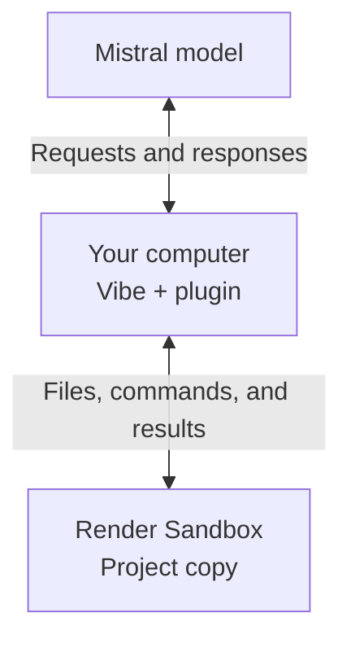

<!-- Keep the project title, status, and navigation together, as in the related integrations. -->
<div align="center">

# Mistral Vibe + Render Sandboxes

**Run Vibe coding tasks in a temporary cloud environment.**

[Install](#installation) · [Usage](#usage) · [Guide](guide/README.md)

</div>

[Mistral Vibe](https://github.com/mistralai/mistral-vibe) is a coding assistant you use from a terminal. This plugin lets it read, edit, and test a copy of your Git project in a [Render Sandbox](https://render.com/docs/sandboxes), a temporary Linux computer on Render.

Ask Vibe to fix a bug or make a change. The plugin copies your source to Render, runs the coding task, and brings back the edits as a **patch**, a file you can review before applying. Your original source files stay unchanged.

## Prerequisites

- macOS or Linux, [Git](https://git-scm.com/install/), and [uv](https://docs.astral.sh/uv/getting-started/installation/), which installs Python and the libraries this plugin needs.
- A [Render workspace with Sandboxes enabled](https://render.com/docs/sandboxes#1-confirm-access) and access to a Mistral model that can request code edits and commands.
- A small Git project whose dependencies are already available in the sandbox. Outbound network access is blocked, so the sandbox cannot download packages. The [guided example](guide/README.md) uses Python's built-in libraries.

This is a community development preview using **Vibe 2.26.1** and **Render's Python library 1.2.0**. The installation below includes the supported Vibe version. Coding tasks incur Render compute and model charges.

## Installation

### 1. Download and install

In a terminal, enter the folder where you keep projects, then run:

```shell
# Download the plugin and enter its folder.
git clone https://github.com/ojusave/vibe-render-sandboxes.git
cd vibe-render-sandboxes
# Install Python 3.12 and the tested library versions into .venv.
uv sync --python 3.12 --locked
```

Keep this folder in place after installation. Your project's plugin will use the programs installed in its `.venv` folder.

### 2. Add your credentials

From the downloaded plugin folder, create a private settings file:

```shell
# Keep settings in a folder excluded from Git and sandbox uploads.
mkdir -p .vibe
# Copy the template, preserving an existing settings file.
cp -n .env.example .vibe/render.env
# Allow only your user account to read or change the file.
chmod 600 .vibe/render.env
```

Open `.vibe/render.env` in your editor and replace these values. An API key authorizes software to make requests to your account; keep the keys private.

| Setting | Purpose | Where to find it |
| --- | --- | --- |
| `RENDER_API_KEY` | Creates and manages sandboxes | [Render Account Settings](https://render.com/docs/api#1-create-an-api-key) |
| `RENDER_WORKSPACE_ID` | Selects the workspace that owns the sandboxes | Workspace **Settings** in the [Render Dashboard](https://dashboard.render.com/); use its `tea-...` ID |
| `MISTRAL_API_KEY` | Lets Vibe request model responses | [Mistral's API key page](https://console.mistral.ai/api-keys) |

Your Render key must have access to the selected workspace. Leave `VIBE_RENDER_MODEL=mistral-medium-3-5` if that model is available to your account. The plugin reads this file directly, so you do not need to paste keys into commands. Existing Render users can also [reuse a saved CLI login](guide/operations.md#reuse-a-render-cli-login).

### 3. Install into your project

Still in the downloaded plugin folder, replace the path below with your Git project's root folder:

```shell
# Select the project whose files should be copied to Render.
PROJECT="/absolute/path/to/your/project"
# Register the plugin for this project using the private settings file.
.venv/bin/vibe-render install --project "$PROJECT" \
  --env-file "$PWD/.vibe/render.env" --provider mistral
```

The command prints `Installed .../.vibe/plugins/render-sandboxes`. It refuses to overwrite an existing installation. Add `.vibe/` and `.vibe-render/` to your target project's `.gitignore` to keep local settings and task logs out of commits.

## Usage

From the same terminal and plugin folder, open the installed Vibe in your target project:

```shell
# Remember the supported Vibe executable before changing folders.
VIBE_EXECUTABLE="$PWD/.venv/bin/vibe"
cd "$PROJECT"
# Open Vibe in the project where the plugin is installed.
"$VIBE_EXECUTABLE"
```

Complete Vibe's login and project-trust prompts if needed. The outer chat uses its own model settings; `.vibe/render.env` supplies the separate sandbox task. If Vibe is already running in the project, enter `/reload`.

Start a task with `/renderSandbox:code`, for example:

```text
/renderSandbox:code Fix the failing tests and run the test suite.
```

Include the specific bug and test command when you know them. Vibe starts the task, checks its progress, and returns the patch location and cleanup status. Ask it to cancel to stop an active task.

Each run saves `changes.patch`, logs, and `receipt.json` under your project's `.vibe-render/runs/<run-id>/` folder. The receipt records the task outcome; `cleanup: terminated` confirms that the sandbox was stopped. Review the patch and test output before accepting it. See [review and apply a patch](guide/operations.md#review-and-apply-a-patch) for the commands.

## How it works

The plugin starts a separate Vibe coding session on your computer. That session talks to the model service, while its file operations and commands run on Render. It downloads the patch before stopping the sandbox.



Render and model keys stay on your computer. Source contents and tool results go to the selected model service. Review source before uploading: common secret filenames are excluded, but secrets embedded in ordinary source files can still be copied. Only the separate coding task runs in Render; the outer Vibe chat and its other tools keep their normal access to your computer.

## Try the sample project

The [step-by-step guide](guide/README.md) runs a complete repair: Vibe fixes a median function from **3 to 2.5** for `[4, 1, 3, 2]`. A second sandbox checks the returned patch against protected tests and additional cases. The guide includes the runnable command, captured output, and cleanup checks.

Render Sandboxes is in early access, and Vibe's remote execution connection is experimental. The outer interactive Vibe chat and prepared dependency snapshots have not been live-tested. This preview handles one task per project and does not provide public app previews or persistent coding sessions. See [limits](guide/operations.md#dependencies-and-limits), [cleanup and recovery](guide/operations.md#cleanup-and-recovery).

[MIT licensed](LICENSE). This is an independent integration example, not an official Mistral or Render product.
