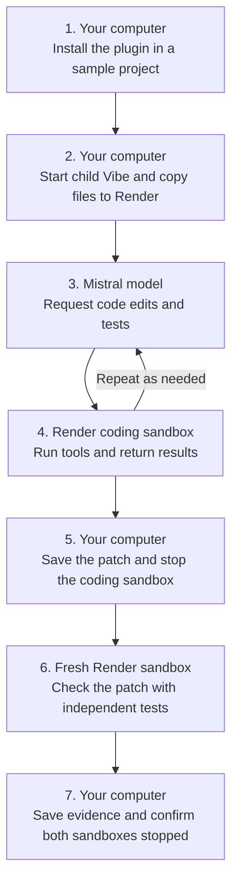

# Run Vibe coding tasks in Render Sandboxes

A coding assistant needs to run its changes to find out whether they work. This plugin gives <a href="https://github.com/mistralai/mistral-vibe/tree/v2.26.1" target="_blank" rel="noopener noreferrer">Mistral Vibe</a>, a coding assistant you use from a terminal, a temporary copy of a project on Render. It edits and tests that copy, then returns proposed changes for you to review. A temporary environment for running code separately from your computer is called a **sandbox**.

In this guide, Vibe fixes a Python function that finds a list's middle value, called its median. For `[4, 1, 3, 2]`, the broken function returns **3 instead of 2.5**. It also rearranges the original list and mishandles an empty list. You will verify the repair against the original tests and additional checks the model did not see.

## How it works

Vibe runs on your computer and asks Mistral's model service what to do next. Actions such as reading a file or running a test are called **tools**. This plugin sends the child coding session's file and command tools to Render through Vibe's experimental agent socket, a connection that carries those requests to another program.

| Part | Where it runs | Its job |
| --- | --- | --- |
| Plugin and child Vibe session | Your computer | Copy the project, request model responses, send tool requests, save the patch, and stop the sandbox |
| Mistral model | Mistral's service | Read supplied source and test results, then request edits and tests |
| Coding sandbox | Render | Hold the project copy and execute the requested file operations and commands |
| Independent verifier | A second Render sandbox | Test the returned changes against protected tests and extra cases |



The plugin keeps account keys on your computer. Neither Render nor Mistral credentials are injected into the sandbox. Source contents and tool results are sent to Mistral for the coding task. The original project files stay unchanged; a **patch** is the separate file describing the proposed changes.

Only the child coding task uses this connection. Your outer Vibe chat and its other tools keep their normal access to your computer. This is a native terminal Vibe plugin, separate from Mistral's web products.

> [!NOTE]
> <a href="https://render.com/docs/sandboxes" target="_blank" rel="noopener noreferrer">Render Sandboxes is in early access</a>, and Vibe's agent socket is experimental. This example pins its library versions. Discuss production workloads with your Render contact.

## Prerequisites

- macOS or Linux, <a href="https://git-scm.com/install/" target="_blank" rel="noopener noreferrer">Git</a>, and <a href="https://docs.astral.sh/uv/getting-started/installation/" target="_blank" rel="noopener noreferrer">uv</a>, a program that installs Python and the extra libraries this plugin needs. The command below selects Python 3.12 and creates a private set of libraries in `.venv`, called a Python virtual environment.
- A <a href="https://render.com/docs/sandboxes#1-confirm-access" target="_blank" rel="noopener noreferrer">Render workspace with Sandboxes enabled</a>. Check for **Sandbox Group** in the Dashboard's **+ New** menu. A workspace groups your Render resources.
- Mistral API access and credits for a model that supports tool requests. The tested model is `mistral-medium-3-5`; use a model available to your account.
- Access to a terminal, where you type commands and read their output. All commands below run on your computer, from the downloaded plugin folder unless stated otherwise.

A service accepts requests through an **application programming interface (API)**. An API key authorizes software to make those requests, similar to a password for a program. The keys and workspace identifier below are separate values:

| Setting and creation page | Purpose and required access | Where it is used |
| --- | --- | --- |
| `RENDER_API_KEY`, from <a href="https://render.com/docs/api#1-create-an-api-key" target="_blank" rel="noopener noreferrer">Render Account Settings</a> | Create, copy files to, execute commands in, inspect, and terminate sandboxes in the selected workspace | Host plugin and verification program |
| `RENDER_WORKSPACE_ID`, from workspace **Settings** in the <a href="https://dashboard.render.com/" target="_blank" rel="noopener noreferrer">Render Dashboard</a> | The `tea-...` identifier selects where to create resources; it is not a secret. Your Render account must have access to that workspace. | Host plugin and verification program |
| `MISTRAL_API_KEY`, from <a href="https://console.mistral.ai/api-keys" target="_blank" rel="noopener noreferrer">Mistral's API key page</a> | Make chat requests with tool calling to the selected model | Host Vibe model process |

Each walkthrough run makes paid model requests and creates two temporary Render sandboxes, one after the other. The coding task has a five-minute deadline and a 100,000-token limit; these bound usage, not an exact dollar cost. There is no website or permanent Render service to deploy.

## 1. Clone and install

In your terminal, enter the folder where you keep projects. Download the repository, a step called **cloning**, and install its tested library versions:

```shell
# Download the plugin and enter its folder.
git clone https://github.com/ojusave/vibe-render-sandboxes.git
cd vibe-render-sandboxes
# Install Python 3.12 and the versions recorded in uv.lock.
uv sync --python 3.12 --locked
```

Installation creates `.venv/bin/vibe-render` and `.venv/bin/vibe`. This path installs Vibe 2.26.1 alongside the plugin, so you do not need a separate global Vibe installation.

## 2. Configure access

Create a private settings file from the template. These commands do not print anything on success:

```shell
# Keep settings in a folder excluded from Git and sandbox source uploads.
mkdir -p .vibe
# Preserve an existing settings file if you have already completed this step.
cp -n .env.example .vibe/render.env
# Restrict this file to your computer's user account.
chmod 600 .vibe/render.env
```

Open `.vibe/render.env` in a text editor. Dot-prefixed folders may be hidden, so enter the full path in your editor's **Open File** dialog. Replace the placeholders for `RENDER_API_KEY`, `RENDER_WORKSPACE_ID`, and `MISTRAL_API_KEY`. Leave `VIBE_RENDER_MODEL=mistral-medium-3-5` if your account supports it.

The helper reads this file directly. You do not need to paste keys into commands or load the file into your shell. Keep it outside commits and screenshots. The file is retained locally so the installed plugin can read it on later runs.

If you already use Render's command-line program, you can reuse its login instead of creating another Render key. See <a href="operations.md#reuse-a-render-cli-login" target="_blank" rel="noopener noreferrer">the CLI login option</a>.

## 3. Run and independently verify the example

The <a href="run_example.py" target="_blank" rel="noopener noreferrer">walkthrough helper</a> copies the <a href="../examples/tiny-calc" target="_blank" rel="noopener noreferrer">small broken project</a> to a new local evidence folder and installs the native plugin there. It invokes the same installed tool program Vibe uses. That interface is called the **Model Context Protocol (MCP)**, a shared format for discovering and calling tools.

Run this from `vibe-render-sandboxes`:

```shell
# Start a real paid coding task through the installed plugin, then check its patch.
.venv/bin/python guide/run_example.py --env-file "$PWD/.vibe/render.env"
```

The helper first confirms that the supplied original tests fail. Then it asks Vibe to repair `stats.py`, leave `test_stats.py` unchanged, preserve the input list, and run the tests. After Vibe finishes, the helper applies the patch only to a disposable review copy. A fresh Render sandbox runs the four protected original tests, six additional numeric cases, input-preservation checks, and empty-input handling.

The terminal can be quiet while Render starts or the model generates a response. `starting` means the sandbox is being prepared; `coding` means Vibe has started its task. `finished` alone does not prove the code works. The independent checks happen afterward.

Example output, abbreviated from the live run; paths and run IDs differ:

```text
Evidence: .../artifacts/guide-...
Original tests: expected failure reproduced
Started plugin task ...
Task state: starting
Task state: coding
Task state: finished
...
Independent verification: passed
Original project: unchanged
Coding and verification sandboxes: terminated
```

If the command exits with `Verification failed`, keep the evidence folder printed above it. Use <a href="operations.md#when-a-run-fails" target="_blank" rel="noopener noreferrer">the failure and recovery instructions</a>; do not treat a model's answer as a passing result.

## 4. Inspect the result and cleanup

Open the `Evidence:` folder printed by the command:

| File | What to check |
| --- | --- |
| `baseline-tests.log` | The original code failed before the repair |
| `plugin-receipt.json` | `state` is `finished`, both cleanup fields are `terminated`, `original_project_unchanged` is `true`, and `independent_checks` says it passed |
| `independent-checks.log` | The four original tests and two extra test methods finish with `OK`; the first extra method checks six numeric cases and preserves inputs |
| The receipt's `patch` path | The proposed changes, saved before the coding sandbox was stopped |

The helper stops the coding sandbox before starting verification, then stops the verifier even if its tests fail. It confirms each exact sandbox ID is in Render's terminated list. Termination destroys the remote filesystem. The patch, original source copy, and logs remain on your computer under `artifacts/`; review them before deleting that folder.

No hosted model session or permanent Render service is created. The local credential file remains in `.vibe/render.env`; remove that file after your last use if you do not want to retain credentials. Removing local files does not stop a sandbox. If cleanup is unconfirmed, use the recorded sandbox ID and <a href="operations.md#cleanup-and-recovery" target="_blank" rel="noopener noreferrer">retry termination</a> first.

## 5. Use the plugin in your project

After the example succeeds, install the plugin into a small Git project. For this first use, choose a project whose required packages already exist in the sandbox. Outbound network access is denied, so commands cannot download packages. A prepared dependency snapshot is optional but has not been live-tested with this plugin; see <a href="operations.md#dependencies-and-limits" target="_blank" rel="noopener noreferrer">dependencies and limits</a> before using it.

Run the following from the downloaded `vibe-render-sandboxes` folder, replacing the project path:

```shell
# Select the root folder of the Git project you want Vibe to work on.
PROJECT=/absolute/path/to/your/project
# Install project-specific tools that read your existing private settings file.
.venv/bin/vibe-render install --project "$PROJECT" \
  --env-file "$PWD/.vibe/render.env" --provider mistral
```

The installer prints `Installed .../.vibe/plugins/render-sandboxes`. It refuses to overwrite an existing installation. It records the selected project, settings path, and Python executable, so keep this downloaded plugin folder and its `.venv` in place.

In your target project's `.gitignore`, add `.vibe/` and `.vibe-render/` to keep local plugin settings, source copies, prompts, and run logs out of commits. Review your source before the first task: exclusions cover common secret filenames, but they cannot recognize secrets stored in arbitrary source files.

Save the Vibe executable's location, change to your project, and open it:

```shell
# Remember the installed Vibe before leaving this folder.
VIBE_EXECUTABLE="$PWD/.venv/bin/vibe"
cd "$PROJECT"
# Launch the outer chat. Complete its normal Mistral login if prompted.
"$VIBE_EXECUTABLE"
```

The outer chat has its own <a href="https://github.com/mistralai/mistral-vibe/tree/v2.26.1#quickstart" target="_blank" rel="noopener noreferrer">Vibe login and model settings</a>. The private file configured above supplies the child plugin task. Trust the project when prompted. If Vibe was already open, enter `/reload`, then enter a request such as:

```text
/renderSandbox:code Fix the median calculation in stats.py. Preserve the input list and run python3 -m unittest -v.
```

Replace that example with your project's bug and test command. The skill starts one task, reports its run ID, checks progress, and returns the patch location and cleanup status. Ask it to cancel if you want to stop an active task.

Review changes from your own project before accepting them. See <a href="operations.md#review-and-apply-a-patch" target="_blank" rel="noopener noreferrer">patch review and application</a> for the next commands.

## Related guides

- <a href="https://github.com/ojusave/openrouter-sandboxes/blob/main/guides/openrouter-sandboxes.md" target="_blank" rel="noopener noreferrer">Run OpenRouter agents in Render Sandboxes</a>
- <a href="https://render.com/docs/sandboxes" target="_blank" rel="noopener noreferrer">Render Sandboxes and SDK references</a>
